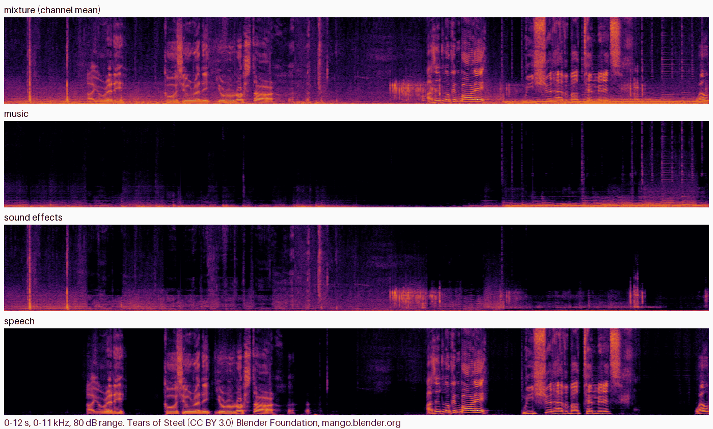

# DBS Soundtrack Separation for ComfyUI

Separate a soundtrack into **music**, **sound effects** and **speech** inside ComfyUI, with the official **Dynamic Band
Splitting (DBS)** models ([JusperLee/Dynamic-Band-Splitting](https://github.com/JusperLee/Dynamic-Band-Splitting),
[paper](https://arxiv.org/abs/2610.14993)). Use it to remove the dialogue of a video and keep its music and effects, to pull the
dialogue out for dubbing or transcription, or to rebalance a mix. The models are tiny (1.0M and 4.7M parameters), run on CUDA or
the CPU, and the three stems add back up to the input. The nodes run the vendored official code and never download anything.

> **Unofficial.** This node pack is an independent integration. It is not affiliated with or endorsed by the DBS authors or by
> Comfy Org.
>
> 日本語の概要は [README.ja.md](README.ja.md) にあります。



*Tears of Steel (CC BY 3.0, Blender Foundation), 12 s of the project page's mixture; below it this pack's DBS-TIGER stems (CPU),
which are bit for bit the official package's output for the same file.*

## What it does

| Node | Purpose |
| --- | --- |
| **DBS Loader** | Picks the model (DBS-TIGER-DnR or DBS-BSRNN-DnR) and the device (`auto` = ComfyUI's GPU when it is CUDA, else `cpu`) |
| **DBS Separate (music / sfx / speech)** | `AUDIO` in → `music`, `sfx`, `speech` (`AUDIO`) and a JSON report |

Connect ComfyUI's **Load Audio** (or **Load Video** → **Get Video Components**) in front. To remove the dialogue, add `music` and
`sfx` with ComfyUI's **Merge Audio** (`add`); the shipped workflows do that, one of them for a video.

- `channels` = `mono`: the channel mean is separated, as the official usage does. `each channel`: every channel is separated on
  its own, which keeps stereo (twice the time for stereo).
- The models work on 44.1 kHz. Other rates are resampled with ComfyUI's own resampler; `output_sample_rate` = `44100` (the
  model's rate) or `input` (resampled back).
- The overlap-add windows of the model cards are used: DBS-TIGER 6 s every 3 s, DBS-BSRNN 3 s every 1.5 s. Any length works.
- The stems are in phase with the input and add back up to it (music + sfx + speech = input, to about 1e-6).
- Batches: every item is separated on its own.

| Model | Parameters | SI-SDR on DnR v2 (music / sfx / speech) | RTX 5090 | CPU (24 threads) |
| --- | --- | --- | --- | --- |
| **DBS-TIGER-DnR** (default) | 1.0M | 7.78 / 6.70 / 15.90 dB | 16x real time | 0.5x real time |
| DBS-BSRNN-DnR | 4.7M | 6.48 / 5.73 / 15.01 dB | 22x real time | 1.8x real time |

SI-SDR: the authors' model cards (not measured here). Speed: measured here, model loaded, channel mean. Without a CUDA GPU,
DBS-BSRNN is the practical choice (DBS-TIGER takes about twice the length of the audio on the CPU).

## How far it was checked

Windows 11, ComfyUI v0.38.0, RTX 5090 and CPU; details and raw numbers in [docs/VERIFICATION.md](docs/VERIFICATION.md):

- **Bit-identical to the official package on the CPU.** On the project page's film clips (Tears of Steel, Sintel; CC BY 3.0) the
  pack's stems equal those of the official README usage (`from_pretrained` + `separate(..., mode="chunked")`), byte for byte, in
  6 of 6 cases (both models, every overlap-add path, per channel). The official side ran in a separate environment with the
  upstream's pinned versions.
- **CUDA:** the official code itself gives slightly different bytes on every run on the GPU; with PyTorch's deterministic
  algorithms on both sides, the pack equals the official output bit for bit in 4 of 4 cases (30 s clips, both models, channel
  mean and each channel).
- **Real ComfyUI queue** (CPU and RTX 5090): Load Audio → DBS → Save Audio (FLAC) gives the official stems to within half a
  16-bit step (the FLAC rounding); the remove-dialogue workflows, including the video one, run through the queue.
- **Clean install:** fresh ComfyUI v0.38.0, fresh Python 3.12 environment, `git clone` of this repository, `pip install -r
  requirements.txt` (nothing new: ComfyUI already brings `einops` and `safetensors`), the models downloaded with
  `tools/download_model.py` (SHA-256 verified), and the real-queue check against the installed pack.
- **CI** (GitHub Actions; Ubuntu and Windows): the real models on the CPU on synthetic audio, the pack compared with the official
  package in the same process for both models, the vendored code compared with the pinned upstream commit, ComfyUI's own
  validation of the workflows, and a real ComfyUI queue; ComfyUI v0.38.0 and v0.42.1.

**Not checked:** separation quality itself (the pack reproduces the official outputs; it does not re-evaluate the models), audio
other than film-like mixtures (singing is likely to end up in "music"), Linux and macOS outside CI, AMD or Apple GPUs (the pack
then uses the CPU).

## Install

1. ComfyUI with the V3 node API (**v0.38.0** or later) and Python 3.10+. A CUDA GPU is optional.
2. Clone this repository into `ComfyUI/custom_nodes/` and install its requirements into ComfyUI's Python (`einops` and
   `safetensors`, which ComfyUI usually has already):

   ```
   git clone https://github.com/hiroki-abe-58/ComfyUI-DBS custom_nodes/ComfyUI-DBS
   python -m pip install -r custom_nodes/ComfyUI-DBS/requirements.txt
   ```

3. Download the models (23 MB for both). The script pins the revisions and verifies every file's SHA-256:

   ```
   python custom_nodes/ComfyUI-DBS/tools/download_model.py --models-dir models/dbs
   ```

   Result: `models/dbs/DBS-TIGER-DnR/` and `models/dbs/DBS-BSRNN-DnR/`, each with `config.json`, `model.safetensors` and the model
   card `README.md`. Another location works through `extra_model_paths.yaml` with the key `dbs`.

4. Restart ComfyUI and open one of `workflows/gui/`:
   - `separate_soundtrack.json`: the three stems as FLAC;
   - `remove_dialogue.json`: music + sfx (the soundtrack without dialogue) and the dialogue, in stereo at the input's rate;
   - `video_remove_dialogue.json`: the same for a video, saved as a new video with the dialogue-free soundtrack.

   Choose your own file in Load Audio or Load Video (the workflows name `soundtrack.wav` and `clip.mp4`).

## Notes and limits

- Trained on DnR v2: English speech (LibriSpeech), music (Free Music Archive) and sound effects (FSD50K) mixed like a film
  soundtrack. Results on other material (songs with vocals, other languages, very loud music) are for you to judge.
- Interrupt stops between two windows.
- On CUDA, repeated runs can differ in the last digits (the official code does the same); start ComfyUI with `--deterministic`
  if you need identical files every time.
- The demo backend of the upstream repository runs DBS-TIGER on the CPU with one thread; here that was slower and not identical,
  so the pack uses PyTorch's default threads, as the README usage does.

## Licenses

- This node pack's code: **MIT** ([LICENSE](LICENSE)).
- Vendored DBS code (`dbs_comfy/vendor`): **Apache-2.0**, by Bingzhe Zhang, Kai Li and Xiaolin Hu, with parts adapted from
  MIT-licensed projects ([NOTICE](NOTICE), `dbs_comfy/vendor/UPSTREAM.md`, `dbs_comfy/vendor/THIRD_PARTY.md`).
- Models (downloaded only by `tools/download_model.py`): **Apache-2.0** (model cards), trained on DnR v2 (CC BY 4.0).

## Development

```
python -m pip install pytest ruff soundfile rotary-embedding-torch huggingface_hub
python tools/download_model.py --models-dir <dir>/dbs
git clone https://github.com/JusperLee/Dynamic-Band-Splitting <upstream> && git -C <upstream> checkout ff526463a58ee0278e7bd05c4b8bce112b743e34
DBS_MODELS_DIR=<dir>/dbs DBS_UPSTREAM_DIR=<upstream> DBS_COMFYUI_DIR=<ComfyUI checkout> python -m pytest tests
python scripts/ci_queue_check.py --comfyui <ComfyUI checkout> --models-dir <dir>/dbs --upstream <upstream>   # real queue on the CPU
python scripts/vendor_sync.py --upstream <upstream> --check                                                 # vendored code check
```

The official package is only needed for the comparison tests (`rotary-embedding-torch` and `huggingface_hub` are what its imports
need), and `soundfile` only for the tests and the check script; the node pack itself imports neither.
